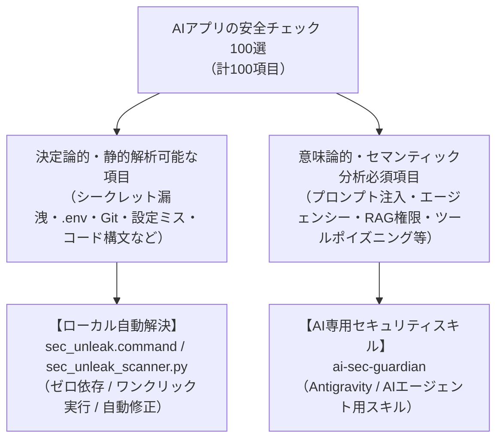

# sec-unleak 🛡️⚡
> **AI & Web App Security Checklist 100 Solution Kit**  
> 「AIアプリの安全チェック 100選」を完全網羅する、**ローカル決定論的ツール** と **AI文脈推論スキル** のハイブリッド・セキュリティソリューション

[](LICENSE)
[]()
[]()
[]()

---

## 💡 コンセプトと二刀流アーキテクチャ

WebアプリケーションおよびAIエージェントのセキュリティ脅威は、大きく2つの性質に分かれます：
1. **決定論的に検査できるもの**（APIキーの直書き、`.env` の誤公開、Git履歴、設定不備、生のSQL文字列結合、危険なコマンド実行など）
2. **意味論的・セマンティックな文脈理解が必要なもの**（プロンプトインジェクション、間接注入、過剰なエージェンシー、ツールポイズニング、RAG権限分離、ハルシネーション悪用など）

`sec-unleak` は、「AIアプリの安全チェック 100選」の全項目をこの2つに切り分け、それぞれに最適な解決策を提供します。



---

## ✨ 主な特徴

### 1. ゼロ依存・超高速ローカル監査エンジン (`sec_unleak_scanner.py`)
- **外部ライブラリ不要**: Python 3 の標準ライブラリのみで動作。`pip install` すら不要です。
- **瞬時にスキャン**: 数千ファイルをわずか数秒で走査。
- **自動修復機能 (`--fix`)**: `.gitignore` の自動生成、必須除外ルールの追記、Git追跡されてしまった `.env` の自動アンステージ (`git rm --cached`) をワンタッチで実行。

### 2. macOS用ワンクリックランチャー (`sec_unleak.command`)
- Finderから**ダブルクリックするだけ**でターミナルが開き、対話型メニューからワンクリックで監査・修正が完了。

### 3. パソコン全体（全開発プロジェクト）一括監査 (`--all`)
- ホームディレクトリ配下に存在する**すべてのGitリポジトリ（数十〜数百件）を自動発見**。
- クラウドストレージ（OneDrive / iCloud）やシステムキャッシュ（Library）を安全に回避しながら、全プロジェクトのセキュリティ状態を一括インデックス化。

### 4. /unslop 思想に基づくフォレンジック・コンソールUI
- AI特有の「スロップ」（安易な絵文字、ネオングラデーション、巨大な角丸、誇大広告コピー）を完全排除。
- 黒とニュートラルグレー基調のDEC/VT100風ターミナルUI、等幅フォント、`tabular-nums`、キーボード操作（数字キー `1`/`2`/`3` での即時フィルタリング）を搭載したプロフェッショナル仕様のHTMLレポートを自動生成。

### 5. 自律型AIセキュリティスキル (`ai-sec-guardian`)
- Google Antigravity / Gemini CLI / Claude Code 等のエージェントに組み込める専用スキル。
- プロンプトインジェクション防壁、MCPサーバーのツールポイズニング監査、Human-in-the-Loop（HITL）承認ゲートの設計、RAGマルチテナント権限分離（Document-level ACL）、スロップスクワッティング（架空パッケージ）実在検証ツールを同梱。

---

## 📦 インストール方法

### 前提条件
- macOS または Linux
- Python 3.8 以上（macOS標準のPythonでOK）
- Git

### 手順

```bash
# 1. リポジトリをクローン
git clone https://github.com/HR0101/sec-unleak.git
cd sec-unleak

# 2. 実行権限を付与
chmod +x sec_unleak.command sec_unleak_scanner.py
```

#### （推奨）どこからでもコマンド呼び出しできるようにする
ターミナルで `sec-unleak` として実行したい場合は、シンボリックリンクを作成するかパスを通します：

```bash
# ~/.local/bin または /usr/local/bin にシンボリックリンクを作成
ln -s "$(pwd)/sec_unleak_scanner.py" ~/.local/bin/sec-unleak
```

#### （AIエージェント利用者向け）Antigravityスキルのグローバル導入
同梱のAIセキュリティスキル `ai-sec-guardian` をAIアシスタントに常時認識させる場合：

```bash
# Antigravityのスキルディレクトリに配置
mkdir -p ~/.gemini/skills
cp -r .agents/skills/ai-sec-guardian ~/.gemini/skills/
```

---

## 🚀 使い方

### 1. macOSのFinderからワンクリック実行
`sec_unleak.command` をダブルクリックするだけです。  
メニューが表示されるので、番号を入力してください：

```text
  ================================================================
      🛡️  AIアプリの安全チェック 100選・ローカル監査ランチャー
  ================================================================

実行モードを選択してください:
  [1] 現在のプロジェクトをスキャン ＋ HTMLレポートをブラウザで開く (デフォルト)
  [2] 自動修正付きスキャン (--fix: .gitignore自動追記 & Gitキャッシュ解除)
  [3] コンソールのみで高速スキャン (ターミナル出力のみ)
  [4] 🌐 パソコン全体（全開発プロジェクト）を一括監査 ＋ 統合HTMLレポート
  [q] 終了
```

---

### 2. コマンドライン（CLI）からの実行

#### 現在のプロジェクトを監査する
```bash
./sec_unleak_scanner.py .
```

#### 自動修正（.gitignore生成 & Git追跡解除）を行い、HTMLレポートを開く
```bash
./sec_unleak_scanner.py . --fix --html
```

#### 🌐 パソコン全体（全Gitリポジトリ）を一括監査する
```bash
./sec_unleak_scanner.py --all --html
```
*※ ホームディレクトリ配下の全リポジトリを自動探索し、統合レポート `system_security_report.html` を生成してブラウザで開きます。*

#### CI/CDパイプライン（GitHub Actions等）でJSON出力する
```bash
./sec_unleak_scanner.py . --json
# 脆弱性が検知された場合は終了コード 1 を返します
```

---

### 3. AI特化セキュリティスキル (`ai-sec-guardian`) の活用

AIによる推論・文脈判断が必要な項目は、チャットやエージェント上でスキルを呼び出します。

#### ① スロップスクワッティング（AI幻覚パッケージ）の実在検証
LLMが提案したライブラリが、攻撃者の罠（タイポスクワッティング/架空登録）でないか公式レジストリ（npm / PyPI）に即座に問い合わせます：

```bash
# npmパッケージの検証
python3 .agents/skills/ai-sec-guardian/scripts/verify_package_hallucination.py npm <パッケージ名>

# Pythonパッケージ (PyPI) の検証
python3 .agents/skills/ai-sec-guardian/scripts/verify_package_hallucination.py pypi <パッケージ名>
```

#### ② 防御プロンプト＆HITL承認ゲートのテンプレート
`.agents/skills/ai-sec-guardian/references/prompt_defense_templates.md` に以下の実装パターンが収録されています：
- **XMLタグによる入力境界分離**: 間接プロンプトインジェクション（No.077）の根本防御
- **システムプロンプト漏洩防止ガードレール**: プロンプト抽出攻撃（No.083）の防御
- **Human-in-the-Loop (HITL) ゲート**: 破壊的ツール実行前の人間承認フロー（No.079）
- **RAG ドキュメントレベルアクセス制御 (ACL)**: テナント分離ベクトル検索（No.089）

---

## 📋 「AIアプリの安全チェック 100選」完全対応マッピング

| 分類 | カバーする主なチェック項目 (100選より) | 担当ソリューション |
| :--- | :--- | :---: |
| **秘密情報・鍵<br>(001〜025)** | ・No.001 APIキーの直書き検知<br>・No.002 .env誤公開検知 & .gitignore自動生成<br>・No.003 Git追跡中シークレットの検査<br>・No.004 クライアント側（NEXT_PUBLIC_等）露出検査<br>・No.006 ログ出力での認証情報混入検知<br>・No.018 Dockerイメージへの.envコピー検知<br>・No.023 コメント内の平文パスワード検知 | **`sec_unleak_scanner.py`<br>(ローカル自動)** |
| **公開・設定<br>(026〜050)** | ・No.035 本番デバッグモード有効化検知<br>・No.039 本番ソースマップ公開検知<br>・No.040 バックアップ・SQLダンプ放置検知<br>・No.045 データベースポート外部開放検知 | **`sec_unleak_scanner.py`<br>(ローカル自動)** |
| **コード・脆弱性<br>(051〜075)** | ・No.051 生SQL文字列結合（SQLインジェクション）検知<br>・No.056 `shell=True` / `os.system` コマンド注入検知<br>・No.071 DOMベースXSS（`innerHTML` 代入）検知<br>・No.075 Zip Slip（無防備なアーカイブ展開）検知 | **`sec_unleak_scanner.py`<br>(ローカル自動)** |
| **サプライチェーン<br>(081, 096)** | ・No.081 & No.096 ロックファイル（package-lock等）存在検査 | **`sec_unleak_scanner.py`<br>(ローカル自動)** |
| **AIエージェント特有<br>(076〜100)** | ・No.076 直接プロンプト注入防御<br>・No.077 間接プロンプト注入（外部文書の罠）防御<br>・No.078 過剰なエージェンシー（ツール権限）の削減<br>・No.079 破壊的操作前の人間承認ゲート（HITL）実装<br>・No.080 スロップスクワッティング（AI幻覚パッケージ）実在検証<br>・No.082 不適切な出力処理（AI出力の無害化サニタイズ）<br>・No.083 システムプロンプト漏洩防止設計<br>・No.087 MCPサーバーのツールポイズニング監査<br>・No.089 RAGベクトル検索の権限分離（Document-level ACL）<br>・No.091 エージェント実行コマンドの許可リスト化<br>・No.098 長期記憶汚染（Memory Poisoning）防御 | **`ai-sec-guardian`<br>(AI専門スキル)** |

---

## 📂 ディレクトリ構成

```text
sec-unleak/
├── sec_unleak.command                  # macOS用ワンクリック監査ランチャー
├── sec_unleak_scanner.py               # 決定論的セキュリティ監査エンジン (Python 3標準ライブラリのみ)
├── AI_APP_SECURITY_100_AUDIT_REPORT.md # 「100選」全カードの徹底監査＆改修指示書
├── README.md                           # 本ドキュメント
├── .gitignore                          # セキュリティ除外設定
└── .agents/
    └── skills/
        └── ai-sec-guardian/             # AI特化セキュリティ守護スキル
            ├── SKILL.md                # スキルメイン定義プロトコル
            ├── scripts/
            │   └── verify_package_hallucination.py # スロップスクワッティング実在検証ツール
            └── references/
                └── prompt_defense_templates.md     # 防御プロンプト＆HITL実装テンプレート
```

---

## 📄 ライセンス

本プロジェクトは [MIT License](LICENSE) のもとで公開されています。
